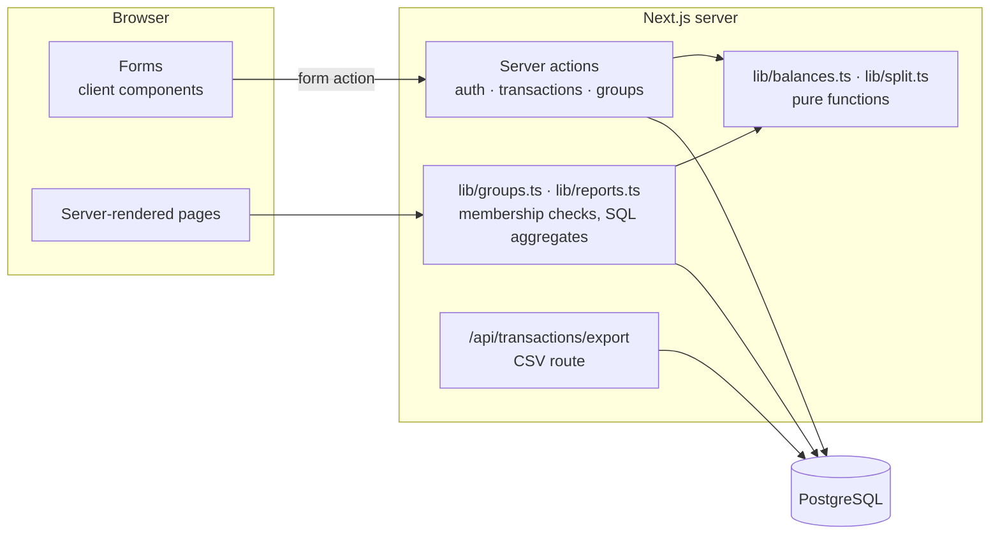
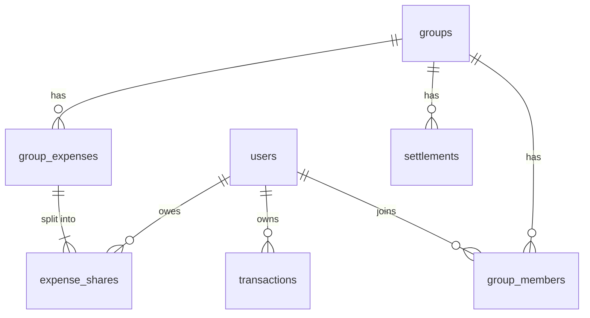

# SplitPal — Expense tracker & bill splitting


Track your own monthly income and expenses, and split shared costs with roommates or travel buddies.
SplitPal works out who owes whom and reduces it to the fewest possible transfers.

**Stack:** Next.js 16 (App Router, Server Actions) · TypeScript · PostgreSQL · Drizzle ORM · Tailwind CSS 4 ·
Zod · Vitest · Playwright · Docker · GitHub Actions

## Features

**Personal finance**

- Add, edit and delete income / expense entries with categories and notes
- Monthly dashboard: income, expenses, balance, daily spending chart, spending by category
- Month-by-month navigation
- CSV export (opens correctly in Excel with Thai text)

**Groups**

- Create a group and invite friends with a link (`/join/<code>`); new users can sign up from the link and
  land back on the invite
- Add shared expenses: split equally between selected members, or enter exact amounts per person
  (with a live "short by / over by" check)
- Per-member balances and a **"who pays whom"** list using a debt-simplification algorithm
- Record settlements ("I paid you back"), with undo
- Regenerate the invite link to revoke the old one

## Engineering highlights

### 1. Money as integers

All amounts are stored as integer **satang** (1 baht = 100 satang). Floating point never touches stored
values (`0.1 + 0.2 !== 0.3`), and splitting never loses a satang: 100 ÷ 3 becomes 33.34 + 33.33 + 33.33
([`src/lib/split.ts`](src/lib/split.ts)). Input like `12.345` is rejected rather than silently rounded.

### 2. Debt simplification

[`src/lib/balances.ts`](src/lib/balances.ts) computes each member's net balance (paid − owed ± settlements;
always sums to zero), then greedily matches the biggest creditor with the biggest debtor. Each step settles
at least one person, so _n_ people need at most _n − 1_ transfers, and chains like A→B→C collapse into A→C.
Finding the true minimum is NP-hard; greedy is the standard practical approach. Covered by unit tests,
including a property-style check that applying the transfers brings everyone to exactly zero.

### 3. Authorization on every query (no IDOR)

- Every group read/write checks membership in the database; non-members get a **404**, not a 403, so the
  app doesn't even reveal that a group exists.
- Personal transactions are filtered by `user_id` in the `WHERE` clause of every select, update and delete.
- Member IDs submitted in forms (payer, participants) are checked against the group's real members.
- Only the creator or payer can delete an expense; only the payer or receiver can record a settlement.

### 4. Data integrity

- An expense and its per-person shares are written in a **single transaction**.
- Database `CHECK` constraints back up the app rules (positive amounts, settlement between two different users).
- Reports use SQL `GROUP BY` aggregates rather than loading every row into JavaScript.

### 5. Security details

- Sessions: signed JWT (HS256) in an `httpOnly`, `SameSite=Lax` cookie; bcrypt password hashes.
- Login throttling, and bcrypt runs even for unknown emails so response time does not reveal which accounts exist.
- `?next=` redirects only accept same-site paths (no open redirect).
- CSV export escapes values and neutralises cells beginning with `= + - @` (spreadsheet formula injection).

## Architecture



### Data model



## Getting started

### Option A — Docker (everything)

```bash
docker compose up --build
# → http://localhost:3001   demo login: nut@example.com / password123
```

### Option B — local Node.js + Docker database

Requires Node.js 20.9+.

```bash
cp .env.example .env            # then set AUTH_SECRET
docker compose up -d db         # PostgreSQL on port 5433
npm install
npm run db:migrate
npm run db:seed                 # optional demo users, transactions and a group
npm run dev                     # → http://localhost:3000
```

Demo accounts (password `password123`): `nut@example.com`, `mint@example.com`, `boss@example.com`.

## Scripts

| Script                                  | What it does                                        |
| --------------------------------------- | --------------------------------------------------- |
| `npm run dev` / `build` / `start`       | Next.js dev server / production build / serve build |
| `npm run db:generate`                   | Generate a SQL migration after editing `schema.ts`  |
| `npm run db:migrate` / `db:seed`        | Apply migrations / insert demo data                 |
| `npm test`                              | Unit tests (Vitest)                                 |
| `npm run test:e2e`                      | Playwright end-to-end tests (desktop + mobile)      |
| `npm run lint` / `typecheck` / `format` | ESLint / `tsc --noEmit` / Prettier                  |

E2E tests register their own users, so they only need a migrated database and a production build.

## Project structure

```
src/
  app/
    (auth)/            Login + register
    (app)/             Protected pages: dashboard, transactions, groups
    join/[code]/       Public invite page
    api/transactions/export/   CSV download
  actions/             Server actions (auth, transactions, groups)
  db/                  Drizzle schema + connection
  lib/                 Pure logic (balances, split, money, csv, dates) + server helpers
  components/          UI components
drizzle/               SQL migrations
e2e/                   Playwright tests
scripts/               migrate + seed
```

## Deploying

Vercel (app) + Neon or Supabase (PostgreSQL) works out of the box. Set `DATABASE_URL` and `AUTH_SECRET`,
then run `npm run db:migrate` against the production database.

## Possible next steps

- Monthly budgets per category with alerts
- Recurring transactions (rent, subscriptions)
- Multi-currency trips with exchange rates
- PromptPay QR code on the "who pays whom" list
